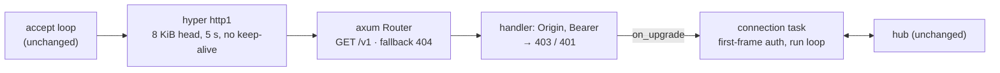

# Implementation plan: axum under the WebSocket API

2026-11-13 · draft for review · implementer: Claude Opus 5.5 · written
against the `triad serve` work in PR #15

## Goal

`triad serve` keeps its protocol and every observable behaviour, but the
listener is an [axum](https://docs.rs/axum/0.8.9) router served by hyper,
and the WebSocket is axum's (`axum::extract::ws`, which is
tokio-tungstenite). The hand-written HTTP request reader goes away, and
there is a router to hang future HTTP routes on.

This is a swap, not a feature. No request, event, close code or flag
changes. `API.md` and `openapi.json` should need no edit.

## Where things stand

`crates/triad/src/ws/mod.rs` (609 lines) holds the listener. About 250 of
them exist only because `tokio-websockets` writes `101` before returning
the request headers:

- `Head`, `read_head`, `HeadRead`: read and parse the request head by hand.
- `refuse`: write an HTTP status by hand.
- `Replay`: an `AsyncRead` wrapper that feeds the bytes already read back
  into `ServerBuilder::accept`.
- `send`: a `poll_fn` around `futures_sink::Sink`, the only reason
  `futures-sink` is in the manifest.

`hub.rs`, `proto.rs` and `requests.rs` know nothing about the socket
library and do not change. The integration tests use their own
hand-written client (`crates/triad/tests/support/ws.rs`), so they are
independent of the server's library and are the contract for this work.

What the lockfile has today, and what axum adds (resolved with
`axum = "=0.8.9"`, features `http1`, `tokio`, `ws`):

| Already locked, same version axum wants | New to the build |
|---|---|
| `hyper` 1.12.0, `hyper-util` 0.1.21, `http` 1.5.0, `http-body` 1.1.0, `http-body-util`, `tower` 0.5.3, `tower-layer`, `tower-service`, `futures-util` 0.3.34, `base64` 0.22.1, `sync_wrapper` | `axum` 0.8.9, `axum-core` 0.5.6, `matchit` 0.8.4, `mime`, `tokio-tungstenite` 0.29.0 and `tungstenite` with its own dependencies, `sha1` 0.10.7 |

Two consequences to accept before starting:

- **The binary gets a second WebSocket implementation.** `iroh-relay` keeps
  `tokio-websockets` in the build whatever triad does. Only its name leaves
  triad's manifest.
- **`sha1` is duplicated** (0.11.0 is locked; axum's `ws` wants 0.10.7).

## Decided (recommendations; say if any is wrong)

**Use tokio-tungstenite through axum, not by name.** axum 0.8.9 pins
tokio-tungstenite 0.29.0, not the current 0.30.0. Naming it separately
would either duplicate it or fight axum's pin. `axum::extract::ws` re-exports
everything the connection loop needs (`WebSocket`, `Message`, `CloseFrame`,
`recv`, `send`), so `futures-sink` leaves the manifest too.

**Serve with hyper directly, not `axum::serve`.** `axum::serve` exposes no
way to set the limits this listener's security rests on. Keep the existing
accept loop and serve each connection with
`hyper::server::conn::http1::Builder` plus `with_upgrades()`, handing it
the router through `hyper_util::service::TowerToHyperService`. That gives:

| Today (by hand) | With hyper |
|---|---|
| Head capped at 8 KiB → `431` | `max_buf_size(8192)` |
| Head must arrive within 5 s → `408` | `header_read_timeout(5 s)` with `hyper_util::rt::TokioTimer` |
| Connection closed after a refusal | `keep_alive(false)` |
| `set_nodelay(true)` | unchanged, still done in the accept loop |

HTTP/1.1 only. No `http2` feature.

**Named dependencies.** `axum = "=0.8.9"` with
`default-features = false, features = ["http1", "tokio", "ws"]`, plus
`hyper` and `hyper-util` at their locked versions with the smallest feature
sets that compile. All three optional behind `ws`. `tokio-websockets` and
`futures-sink` are removed from both manifests. No `tower-http`, no
`macros`, no `json` feature.

**Checks stay in the same order and give the same answers.** Method, path,
`Origin`, bearer token, then upgrade; then the first-frame token if no
header carried one. The 5 s deadline still runs from TCP accept and covers
the head and the first frame together, so the accept time must reach the
handler (a per-connection `Extension`, or build the service per
connection).

**Existing `ws_*` tests are the contract and pass unedited.** If hyper
cannot produce a status a test expects, that is a finding to report, not a
test to change (see Stop and ask).

**No new routes.** No health endpoint, no static files, no REST. The router
has `/v1` and a fallback.

## Design

- **Handler.** Takes `State<Arc<Shared>>`, the headers, the accept
  deadline and `WebSocketUpgrade`. It refuses with a plain response, or
  calls `ws.max_message_size(MAX_FRAME).max_frame_size(MAX_FRAME)
  .on_upgrade(…)`.
- **Connection task.** `connection`'s second half and `run` port almost
  line for line: `ws.next()` becomes `ws.recv()`, `Message::text(s)`
  becomes `Message::Text(s.into())`, and `close` sends
  `Message::Close(Some(CloseFrame { code, reason }))`.
- **Deleted.** `Head`, `read_head`, `HeadRead`, `refuse`, `Replay`, `send`,
  and the unit test `parses_a_request_head`.
- **Kept as is.** `serve` (address checks, token, startup lines), `Shared`,
  `Current`, `load_or_create_token`, `same_token`, `origin_allowed`, every
  constant and close code.

## Milestones

Each ends with `cargo fmt --check`, clippy `-D warnings`, the
`--no-default-features` build, and `cargo test --workspace`.

**A0 — Read, measure, and answer four questions.** Read the docs and
examples for axum 0.8.9 (`extract::ws`, the `serve-with-hyper`
example), hyper 1.12 (`server::conn::http1::Builder`) and hyper-util 0.1.21.
Do not write calls from memory. Record the release binary size and the
`cargo tree` crate count before any change. Then, with a throwaway
listener, find out:

1. What does hyper send when the head exceeds `max_buf_size(8192)`? Is a
   7 KiB head with a token still accepted at that setting?
2. What does `header_read_timeout` do on expiry: `408`, or a silent close?
   Does it also catch a head dripped one byte at a time?
3. What close code does the client see when a message exceeds
   `max_message_size`?
4. What does `WebSocketUpgrade` answer to a `POST /v1` and to a plain
   `GET /v1` with no upgrade headers?

Compare each with what `ws_auth` and `ws_listen` assert. If all match, go
on. If any differs, see Stop and ask.

**A1 — The swap, in one step.** The upgrade and the frame library cannot
be changed separately, since axum's upgrade yields its own socket type. Add the three dependencies,
build the router, serve it from the existing accept loop, port the handler
and the connection task, delete the hand-written pieces, and remove
`tokio-websockets` and `futures-sink` from the manifests. Keep the change
inside `ws/mod.rs` and the two `Cargo.toml` files.

**A2 — Parity.** Run the six `ws_*` test files unedited and fix the
listener until they pass. Then check by hand what no test covers: a ping
from the client is answered, an idle client is pinged every 30 s and
dropped after three misses, a refused request closes the connection, and a
binary frame closes with `1003`. Add a test for any of these that turns
out to be cheap. Run `scripts/vm/serve-test.sh` with `VM_KERNEL=skip`.

**A3 — Record.** Add a subsection to FINDINGS.md's "WebSocket API"
section: the answers to A0's questions, the binary size before and after,
the crates added and removed from the build, the duplicate `sha1`, lines
deleted and added in `ws/mod.rs`, and any behaviour that differs. Correct
the existing "W0: the upgrade path" text and the "Where the plan was
wrong" entry about `futures-sink`, which no longer describe the code.
Update `WEBSOCKET-PLAN.md` only by adding a line that points here.

## Stop and ask

- **A status or close code differs from what a test or `API.md` states**
  and hyper or axum gives no setting to match it. Report the difference
  and the options (accept it and edit the test and `API.md`, or keep that
  one check by hand in front of hyper). Do not edit the test first.
- **The 8 KiB cap cannot be expressed** (hyper's minimum buffer is larger,
  or a legitimate head near the limit is refused).
- **The release binary grows by more than 1.5 MB**, or the VM guest binary
  no longer passes at 64 MB of RAM.
- **axum 0.8.9 does not resolve against the locked `hyper`, `http` or
  `tower`** without changing an existing pin.

## Risks

- **hyper's limits are not the hand-written ones.** A0 exists to find this
  out before any code is deleted.
- **Keep-alive.** With hyper's default, a refused client keeps the
  connection open; `ws_auth`'s raw client reads to end of stream and would
  hang until its timeout. `keep_alive(false)` is expected to fix it; A0
  should confirm.
- **Size.** The first version added 450 KB because its library was already
  linked. This one links axum, tungstenite and a second `sha1`. Expect
  more; measure it.
- **Two frame libraries behave differently at the edges**: fragmented
  messages, invalid UTF-8 in a text frame, close handshakes. The tests
  cover the common paths only.

## What this does not do

- No protocol change, no new request or event, no new flag.
- No HTTP routes beyond `/v1`, no TLS, no HTTP/2, no middleware crates.
- No change to `hub.rs`, `proto.rs`, `requests.rs`, `main.rs` or the tests'
  client.
- Does not remove `tokio-websockets` from the binary; iroh needs it.

## Rules for the implementing agent

The rules in HARNESS-PLAN.md apply: read the pinned version's docs before
calling it, hold the existing pins, existing tests are a contract, never
log a token, stay in scope, three attempts then stop, write FINDINGS.md as
you go.

### Questions the findings must answer

1. The four A0 answers, and whether each matched the existing behaviour.
2. What did the swap cost in bytes and crates, and what did it remove in
   lines?
3. Did any observable behaviour change? Which, and who decided to accept
   it?
4. Is the result simpler to review than the hand-read upgrade it replaced?
