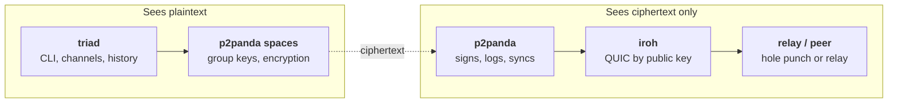

# triad

A command-line chat built to check whether p2panda and iroh fit together into
one stack for encrypted group chat. One user holds any number of encrypted
spaces, each a named channel, as in an IRC client. iroh dials peers by public
key. p2panda keeps a signed append-only log per author, syncs it, and
encrypts every message with its built-in spaces. This is an exploration: the
code is disposable, and [FINDINGS.md](FINDINGS.md) is the deliverable.

An earlier `triad` encrypted with OpenMLS (RFC 9420), following
[SPEC.md](SPEC.md). That code was removed after the comparison in FINDINGS.md
came out in favour of spaces, and the spaces binary, until then
`triad-spaces`, took the name. The OpenMLS code is in the git history up to
`de3f814`, and the findings about it are kept. A data directory written by
the OpenMLS version (it has an `mls.sqlite`) is refused: move it away or pass
a fresh `--data-dir`.

## What the implementation is

One binary, `triad`. One data directory is one user: one identity and
one p2panda node, in any number of spaces. The app talks only to p2panda.
iroh runs inside p2panda, and p2panda encrypts every message before storing
or sending it.



| Layer | Library | Owns |
| --- | --- | --- |
| App | `triad`, `triad-core` | Channels and their names, invites, join prompts, readable history |
| Encryption and membership | p2panda 0.8.0 spaces | Group key agreement, encryption, member list and access levels |
| Log and sync | p2panda 0.8.0 | Signed append-only log per author, SQLite storage, discovery, catch-up |
| Transport | iroh 1.4.1 | QUIC connections dialed by public key, hole punching, relay fallback |

## Status

A prototype, not a reliable chat system. The two-machine acceptance run
passes across two networks
([Milestone 6](FINDINGS.md#milestone-6-p2panda-spaces-on-two-machines-2026-11-11)).
Several channels per user are tested on one machine only. FINDINGS.md lists
what an app still has to handle itself: a removed member is not told, a
removed member who reconnects looks like a new join request, and new members
can read messages from before they joined. p2panda's encryption is its own
protocol, not a standard, and is documented as subject to change before 1.0.

## Prerequisites

| Machine | Needs |
| --- | --- |
| macOS, Apple silicon | Xcode command line tools (`xcode-select --install`), `rustup` with stable Rust 1.96 or newer |
| Linux, x86_64 | A C toolchain (`build-essential` on Debian or Ubuntu), `rustup` with stable Rust 1.96 or newer |

The C compiler is needed because SQLite is compiled from bundled source and
the TLS backend includes C and assembly. `rust-toolchain.toml` pins the exact
toolchain; rustup installs it on first build.

No inbound ports are needed. Each node makes outbound UDP connections for
direct paths and outbound HTTPS to the relay.

## Install

The same command on both machines:

```sh
git clone https://github.com/jamesacklin/triad.git && cd triad
cargo install --path crates/triad --locked
triad whoami
```

`triad whoami` creates this install's identity and prints its node ID.
A clean build takes a few minutes.

## Use

On machine A:

```sh
triad create
```

It creates the channel `#general`, prints an invite (`triad1-…`) and enters
chat mode. On machine B:

```sh
triad join triad1-…
```

A is asked `join request for #general from 7c1d09ee. Accept? [y/N]`. After
`y`, both sides print that B joined. Then type a line and press Enter to send
it. Lines starting with `/` are commands.

Later, `triad chat` opens every channel again. Someone who has the
missed messages must be online for a member to catch up, because there is no
always-on node.

| Command | Behavior |
| --- | --- |
| `whoami` | Print the node ID. Create credentials if the data directory is new. |
| `create [--name <name>]` | Create a channel (default `general`) with your bot in it, print its invite, enter chat mode. |
| `join <invite> [--name <name>]` | Add a channel from an invite, enter chat mode, wait to be added. |
| `chat [--channel <name>]` | Open every channel in chat mode, focused on the named or first one. |
| `channels` | List the channels in this data directory. |
| `invite [--channel <name>]` | Print an invite to a channel this node has joined. |
| `history [--channel <name>] [--limit N]` | Print stored messages, oldest first: one channel, or all in one timeline. |
| `status` | Print role, join status and operation counts for every channel. |
| `reset [--yes] [--keep-bot-config]` | Delete everything in the data directory (channels, history, identity, bot settings and keys) and print a new node ID. Asks you to type `reset` unless `--yes`. `--keep-bot-config` keeps `agent.json`, `mcp.json` and `keys.json`. Refuses a directory with no triad files in it. Quit any session using the directory first. |
| `inspect --grep <text>` | Scan the raw bytes of `p2panda.sqlite` for the text. Exit 0 if absent, 1 if found. |
| `probe listen` | Start a raw iroh echo endpoint and print its address. |
| `probe connect <addr>` | Connect, echo one line, report whether the path was direct or relayed. |

| Flag | Applies to | Meaning |
| --- | --- | --- |
| `--data-dir <path>` | All | Use this data directory (default `~/Library/Application Support/triad` on macOS, `~/.local/share/triad` on Linux). |
| `--relay <url>` | `create`, `probe` | Override the default relay (`https://use1-1.relay.n0.iroh.link./`). Joiners take the relay from the invite. |
| `--auto-accept` | `create`, `join`, `chat` | Accept every join request, in every channel this node manages, without asking. |
| `--no-bot` | `create`, `join`, `chat` | Run without your bots ([Bots](#bots)). Also `TRIAD_NO_BOT=1`. |
| `--plain` | `create`, `join`, `chat` | Use the line-based prompt instead of the [terminal interface](#terminal-interface). |
| `--json` | chat mode | Print one JSON object per event (`ready`, `channel`, `switched`, `join_request`, `joined`, `removed`, `promoted`, `message`, `sync_started`, `sync_ended`, `error`). |
| `-v` | All | Also print sync and connection events. |

Exit codes: 0 success, 1 runtime error, 2 usage error.

One data directory is one user. To run two users on one machine, give each
its own `--data-dir`.

### Channels: several spaces per user

Each channel is its own p2panda space, with its own members, keys and
history. Chat mode opens all of them at once and tags every line with its
channel.

| In chat mode | Behavior |
| --- | --- |
| plain text | Send to the focused channel, up to 2,000 bytes. Over 400 bytes it goes as a long message: encrypted beside the space, because p2panda 0.8 cannot read back a longer space message ([FINDINGS.md](FINDINGS.md#long-messages-2026-11-12)). |
| `/create <name> [--no-bot]` | Create a channel, focus it, print its invite. It gets your bot unless `--no-bot`. |
| `/join <invite> [name]` | Join a channel and focus it. Messages there stay disabled until a manager adds you. |
| `/switch <name>` (`/s`) | Focus another channel. |
| `/msg <name> <text>` | Send to a channel without switching. |
| `/me <action>` | Send an action, shown as `* name action`, as in IRC. Builds older than this show only the action text. |
| `/channels` (`/list`) | List channels; `*` marks the focused one. |
| `/invite [name]` | Print an invite to the focused or named channel and copy it to the clipboard (not with `--json`). With no system clipboard (over SSH, say) it asks the terminal to copy instead (OSC 52), which most terminals allow. On Linux the copy may be lost when triad quits, unless a clipboard manager keeps it. |
| `/members`, `/status` | Show the focused channel's members and counts. |
| `/add <node>`, `/remove <node>`, `/promote <node>` | Change the focused channel's membership. Needs `Manage` access. |
| `/nick <name>` | Change your nickname in every channel. |
| `/quit` | Leave chat mode. |

Names are local labels: 1 to 32 characters of `a-z`, `0-9`, `-` and `_`, with
an optional leading `#`. An invite carries the inviter's name as a suggestion.
If that name is taken, the joiner gets it with the space ID appended, or
passes its own. Every JSON event about a channel has a `channel` field.
`ready` describes the focused channel and lists all of them in `channels`.

There is no `/leave` yet. A `state.sqlite` from before channels is migrated
on first open, and its group becomes `#main`.

### Bots

Every session runs your bots unless you pass `--no-bot`
([HARNESS-PLAN.md](HARNESS-PLAN.md), results in
[FINDINGS.md](FINDINGS.md#bots-2026-11-11)):

- **A personal bot** in `#agent`, a space with you as its only member,
  created on first use. It answers every line you type there.
- **A channel bot** in every channel you create, announced to members.
  Members address it with `@bot`. Admins (`Manage`) may use all its tools;
  other members get answers and no tools unless you grant some. It keeps
  answering after a restart, as long as the session runs bots.

To add your bot to a channel you created without one (`--no-bot`, `/create
<name> --no-bot`, or before a model was configured), focus the channel and
type `/bot on`. In a session that started without bots, that starts them
first. `/bot off` removes it.

If no model is chosen yet, or the model has no key, the session prints why
and what to type (`bot_unavailable`) and runs as a plain chat; `/bot on`
tries again.

Every message in a bot turn goes to the model provider in plaintext.

#### Choosing the model

The model is any one [rig-core](https://docs.rs/rig-core/0.46.0) 0.46 can
reach, named `vendor/model`. There is no default: you pick the vendor, and
with it who reads your bots' messages. Until you do, the bots stay off.

The quickest setup is from chat mode, without restarting:

```
/bot model openai/gpt-5.5
/bot provider-key sk-...
```

`/bot model` saves the model in `agent.json`. `/bot provider-key` saves the
key for the model's vendor (or `/bot provider-key <vendor> <key>` for another
vendor) in `keys.json` in the data directory, readable only by you (mode
0600). The terminal interface shows the key as dots while you type it, and
it is never logged. Once the model has a key, the bots start, or switch to
the new model if they are already running. Each channel whose bot you run is
told where its messages now go. A vendor's environment variable, when set,
wins over a saved key.

| Model | Key |
| --- | --- |
| `anthropic/claude-opus-5-5` | `ANTHROPIC_API_KEY` |
| `openrouter/anthropic/claude-opus-5.5` | `OPENROUTER_API_KEY` |
| `openai/gpt-5.5` | `OPENAI_API_KEY` |
| `gcp.gemini/<model>` | `GEMINI_API_KEY` |
| `ollama/qwen3:4b` | none (a local server) |

Other vendors: `azure.openai`, `cohere`, `deepseek`, `groq`, `huggingface`,
`mistral`, `moonshot`, `perplexity`, `together`, `xai` and the rest of rig's
registry. A misspelt vendor gets an error that lists them all, and a missing
key gets one that names the variable. Tools need a model that supports tool
calls.

Set the model in `agent.json` in the data directory, kept between sessions:

```json
{ "model": "openrouter/anthropic/claude-opus-5.5" }
```

| `agent.json` field | Variable (wins over the file) | Meaning |
| --- | --- | --- |
| `model` | `TRIAD_AGENT_MODEL` | `vendor/model`. |
| `base_url` | `TRIAD_AGENT_BASE_URL` | Replaces the vendor's endpoint: a proxy, or a local server on another port. |
| `persona` | `TRIAD_AGENT_PERSONA` | A file whose text is added to the system prompt (relative to the data directory). |
| `builtin` | `TRIAD_AGENT_BUILTIN` (`on` or `off`) | `false` leaves out the [built-in tools](#built-in-tools). |

`TRIAD_AGENT_BRAIN=mock` runs a scripted stand-in with no model (the tests
use it). The older `TRIAD_AGENT_BRAIN=anthropic` and `=openrouter` still
work: they pick the vendor for a model named without one. Any other model
must name its vendor. Limits:
`TRIAD_AGENT_MAX_AGE_SECS`, `TRIAD_AGENT_ASKER_PER_HOUR`,
`TRIAD_AGENT_CHANNEL_PER_DAY`, `TRIAD_AGENT_BURST_PER_MINUTE`,
`TRIAD_AGENT_MAX_STEPS`. MCP servers go in `mcp.json` in the data
directory, tokens named by environment variable.

#### Built-in tools

Your bots have these without any MCP server. They are named like MCP tools,
so grants (`/grant <node> web.*`), the audit log and the rule that admins
get every tool apply to them unchanged.

| Tool | What it does |
| --- | --- |
| `web.search` | Searches the web through the [Brave Search API](https://brave.com/search/api/). Needs a key: `/bot provider-key brave <key>`, or `BRAVE_API_KEY`. Queries go to Brave. |
| `web.fetch` | Fetches a public page over http or https and returns its text. No JavaScript, no logins. The request comes from your machine, so the site sees your address. |
| `time.now` | The date and time in UTC. |

In your DM (`#agent`) only, the personal bot also has a memory that lasts
between conversations:

| Tool | What it does |
| --- | --- |
| `memory.save` | Saves a fact, preference or note (at most 2,000 bytes; at most 2,000 memories). A pinned one is shown to the bot in every DM turn (2,000 bytes of them in all). |
| `memory.search` | Finds memories by their words, newest first. |
| `memory.forget` | Deletes one by its ID. |

| `schedule.add` | Schedules a prompt: once (`at`: `in 20m`, `09:00`, `2026-11-13 09:00`) or repeating (`every`: `30m`, `1d`, at least `5m`, with an optional `time` of day). At most 50. |
| `schedule.list`, `schedule.remove` | Lists schedules, or removes one by its ID. |

Memories and schedules are rows in `state.sqlite` (encrypted with it under
SQLCipher). Channel turns are never offered these tools and never see a
memory, and a channel is not told they exist.

In the DM the bot also has more room: replies up to 16,000 bytes (sent as
long messages, since only you read the DM), up to 4,096 output tokens per
model request and 24 tool calls per turn (`TRIAD_AGENT_DM_MAX_STEPS`). A
channel's bot keeps one message of 2,000 bytes, 1,024 tokens and 8 tool
calls (`TRIAD_AGENT_MAX_STEPS`).

**Skills** are standing instructions you write as `skills/<name>.md` in
the data directory (`<name>` is letters, digits, `-` and `_`). When the bots
start, every turn's system prompt lists each skill with a one-line summary
(the `description:` of YAML front matter, else the file's first line), and
`skills.read` lets the bot read one before a task it covers. `skills.read`
works in channels too, for askers whose tools allow it, and reads nothing
outside `skills/`. Skills and the persona (`persona.md` in the data
directory, or the file `persona` in `agent.json` names) are read again at
every turn, so edits apply from the next one; only the first skill, which
creates `skills/`, needs the session restarted before `skills.read` exists.

### Seeing and changing what the bot keeps

Everything is in the data directory (`~/.local/share/triad` by default).
`triad bot` shows where, and these work whether or not a chat session is
running:

| Command | What it does |
| --- | --- |
| `triad bot` | Counts and paths: memories, schedules, skills, persona, `agent.json`, `mcp.json`. |
| `triad bot memory [query]` | Lists memories. `--edit` opens them all in `$VISUAL`/`$EDITOR`, one per line (`<id> [*] <text>`, `*` = pinned): delete a line to forget it, change it to edit it, add `+ text` for a new one. |
| `triad bot schedules` | Lists schedules. `--edit` opens them as `<id> \| <next> \| <every> \| <name> \| <prompt>`, the same way. |
| `triad bot skills [name]` | Lists skills or prints one. `triad bot skills <name> --edit` writes `skills/<name>.md`. |
| `triad bot persona [--edit]` | Prints or edits the persona, the standing instructions in every turn. |
| `/prompt` (in chat) | The system prompt and tools a turn of yours in the focused channel gets right now. |

An edit that cannot be applied changes nothing and leaves your edited file
in the data directory to copy from.

A schedule fires by posting its prompt in `#agent` as a line from you,
`[scheduled: <name>] <prompt>`, which the bot answers like any other. It
fires only while triad is running with bots: a one-shot that came due while
it was not running fires on the next start if it is less than a day late and
is dropped otherwise; a repeating one fires once for everything it missed.
Times are UTC, or set `"utc_offset_minutes"` in `agent.json` (`-300` for
UTC-5; there is no time zone database, so change it for daylight saving).

`web.fetch` connects only to public addresses. It refuses this machine,
private and shared networks and link-local addresses, and checks every
redirect, so nobody can have your bot read your own network. A tool's result
is cut to 24,000 bytes before the model sees it. An MCP server named `web`
or `time` is left out, with a warning at start.

| In chat mode | Behavior |
| --- | --- |
| `/bot`, `/bot on`, `/bot off` | Show the focused channel's bot, add yours to it, or remove it. On and off: creator only. |
| `/bot model [vendor/model]` | Show your bots' model, or set it ([Choosing the model](#choosing-the-model)). |
| `/bot provider-key [vendor] <key>` | Save the key for the model's vendor, or the named one, and start the bots. |
| `/grant <node> <server.tool \| server.*>`, `/revoke <node> [pattern]`, `/grants` | Edit grants in the focused channel. Host only. |
| `/block <node>`, `/unblock <node>` | Nodes your bots never answer, in every channel you host. |
| `/audit [N]` | The focused channel's last tool calls: who asked, which tool, outcome. Host only. |
| `/memory [query]`, `/forget <id>` | List (or search) what your personal bot remembers, or delete one memory. |
| `/schedules`, `/unschedule <id>` | List your personal bot's schedules, or remove one. |

## Terminal interface

On a terminal, `create`, `join` and `chat` open a full-screen interface:

```
┌ channels ────────┐┌ #garden · 2 members · creator ───────────────────┐
│  agent (DM)      ││sam: hello                                        │
│* garden          ││me: @bot what's on the calendar?                  │
│  ops (…)       2 ││bot: …                                            │
└──────────────────┘└──────────────────────────────────────────────────┘
 bot on (mine) · anthropic · tools calendar │ turn running 4s → calendar.list_events ok │ queue 1
┌──────────────────────────────────────────────────────────────────────┐
│> message #garden or /command                                         │
└──────────────────────────────────────────────────────────────────────┘
```

- **Channels** on the left: your bot's DM first, `*` on the focused one,
  `(…)` on one still waiting to be let in, and a count of unread messages.
  Hidden below 60 columns.
- **The chat pane**: the focused channel's stored history (the last 500
  messages), then live messages and that channel's notices. Its title gives
  the member count and your role.
- **The status line**: the focused channel's bot (yours, someone else's, or
  none; the provider and tool servers), the running turn with its elapsed
  time and current tool call, the queue, the last turn's time and tokens, a
  join request waiting for you, and the last error.
- **The input line**: plain text goes to the focused channel; a line
  starting with `/` is a command, the same as in plain mode.

| Key | Action |
| --- | --- |
| Enter | Send the line. |
| Ctrl-N / Ctrl-P, Alt-Down / Alt-Up | Focus the next or previous channel. |
| PgUp / PgDn | Scroll the chat pane. It stays put while new messages arrive, until you scroll back down. |
| Mouse wheel | Scroll the chat pane or the channel list, whichever is under the pointer. |
| Tab, Up / Down | When a line starts with `/`, the matching commands (and channel names after `/switch`, `/s`, `/msg`, `/invite`) are listed above the input box. Up and Down pick one; Tab puts it in the line. |
| Left, Right, Home, End, Ctrl-A, Ctrl-E | Move in the line. |
| Backspace, Delete, Ctrl-U, Ctrl-W | Delete a character, everything before the cursor, or a word. |
| Ctrl-C, or Ctrl-D on an empty line | Quit (`/quit`). |

A join request shows in the status line as `join request for #garden from
7c1d09ee — y/N`; the next plain line answers it, as at the plain prompt.
`/nick <name>` changes your nickname in every channel, as `--nickname` does
at start. The interface takes the mouse for the wheel, so select text with
Shift held (Option on macOS Terminal and iTerm2). `/invite` copies the
invite for you.

`--plain` keeps the line-based prompt. So does output to a pipe or input from
one, and a build without the `tui` feature (`cargo build -p triad
--no-default-features`). `--json` is unaffected.

To try two identities on one machine, open two terminals and give each its
own data directory:

```sh
TRIAD_AGENT_BRAIN=mock triad --data-dir /tmp/alice --nickname alice create --name garden
# copy the invite from alice's pane, then in the second terminal:
triad --data-dir /tmp/bob --nickname bob join triad1-…
```

Alice answers `y` to bob's join request. `TRIAD_AGENT_BRAIN=mock` gives
alice a bot that echoes `@bot` asks with no model key.

## WebSocket API

`triad serve` runs a session with no terminal and puts it on a WebSocket,
for a web or mobile front end, a script, or a harness outside a VM:

```text
$ triad serve
listening  ws://127.0.0.1:7878/v1
token      /home/me/.local/share/triad/api-token
```

Clients authenticate with the token in that file (`Authorization: Bearer`,
or a first frame `{"op":"auth","token":"…"}` from a browser), then receive
the same events `--json` prints, one JSON object per frame, and send
requests such as `{"id":1,"op":"send","channel":"garden","text":"hello"}`.
Any `/command` runs through `{"id":2,"op":"command","channel":"garden","line":"/members"}`.
Replies go to the client that asked; changes go to everyone.

It listens on loopback only unless given `--allow-remote`, has no TLS (use
an SSH tunnel or a proxy), and refuses connections from web pages unless
their origin is passed with `--allow-origin`. [API.md](API.md) documents
every request, event and close code, and the reconnect recipe;
[openapi.json](openapi.json) has the same frames as OpenAPI 3.1 schemas for
generating clients. Build without it with `--no-default-features` (or drop
the `ws` feature).

## Web app

[`web/`](web/README.md) is a single-page app that does in a browser what the
terminal interface does: channel list, chat pane with history paging, the
status line, join requests as Accept and Decline buttons, and one input box
where `/` opens the command list. It talks only to `triad serve` over the
WebSocket and holds no session logic. React, Vite, TypeScript, Tailwind and
shadcn/ui.

`triad` can serve it itself. Released builds (the ones `triad update`
installs) always embed it. To build it yourself, build the app, then `triad`
with the `web` feature (not a default, so a plain build needs no Node):

```sh
pnpm -C web install --frozen-lockfile && pnpm -C web build
cargo build -p triad --features web
triad serve
```

`serve` then prints `open http://127.0.0.1:7878/`; open it and paste the
token. A page served this way on a loopback address needs no
`--allow-origin`. Without the feature, `/` says the build has no web app.

For working on the app, `scripts/web-dev.sh` starts `triad serve` with the
mock bot and `--allow-origin http://localhost:5173`, prints where the token
is, and runs the Vite dev server; open <http://localhost:5173>. The page
keeps the token for the tab only, unless "remember on this device" is
ticked. Node and pnpm are needed only for the app.

## Updates

`triad` can update itself from a release published as static files, over
plain HTTP. The source is not trusted: a release is accepted only if its
manifest is signed by a key compiled into the running binary and the
downloaded binary matches the manifest's size and SHA-256. An older manifest
than one already seen is refused, and so is one past its expiry date.

```
<url>/manifest         a signature, then JSON: seq, version, expires, a hash per target
<url>/blobs/<sha256>   the binaries
```

```sh
triad update --url http://updates.example/triad            # is there a newer release?
triad update --url http://updates.example/triad --slots DIR  # download, check and install it
```

With `--slots` the release goes into the one of two slots (`DIR/a`,
`DIR/b`) that is not running, `DIR/current` is switched to it, and the exit
status is 10: restart `triad` from the slot `current` names. This is made
for a supervisor, and the one that exists is the VM guest's init
([scripts/vm/init.c](scripts/vm/init.c)): it runs the updater every few
hours as a short-lived process, restarts `triad` into a new release, and
goes back to the previous slot if the new binary does not stay up. See
[scripts/vm/README.md](scripts/vm/README.md). A `triad` installed with
`cargo install` can look for a release but does not yet replace itself.

To publish:

```sh
triad release keygen release.key        # once; prints the public key, keep the file offline
RELEASE_KEY=release.key TRIAD_UPDATE_URL=http://updates.example/triad \
  scripts/release.sh 0.2.0 1 ./site     # version, release counter, output directory
```

`scripts/release.sh` builds the web app, then `triad` for the machine it
runs on with the web app embedded (the `web` feature, so it needs Node and
pnpm) and the public key and the URL compiled in, and writes `./site`; upload `blobs/` first and
`manifest` last. A build with no key compiled in (`cargo install`, the tests)
takes `TRIAD_UPDATE_KEYS` from the environment instead. Anyone who has the
signing key can run code on every install that trusts it, and anyone who can
reach the source can download the binary.

## Acceptance run (two machines)

Put the machines on different networks, for example the Mac on home Wi-Fi and
the Linux machine on a cloud VM or a phone hotspot. Both machines need
`triad` installed as above.

1. Mac: `triad create --no-bot --auto-accept -v`. Copy the invite.
2. Linux: `triad join <invite> --no-bot -v`.
3. Both: confirm the output shows 2 members.
4. Mac: send `mac-01` through `mac-10`. Linux: send `linux-01` through `linux-10`.
5. Both: `triad history` lists 20 messages, with each sender's messages in order.
6. Linux: `/quit`. Mac: send `mac-11` through `mac-15`.
7. Linux: `triad chat --no-bot -v`. Expect one sync and exactly five new messages.
8. Both: `/quit`, then `triad inspect --grep mac-01` and `triad inspect --grep linux-01`. Both must exit 0.
9. Both: `triad status` shows `failed=0`.
10. Repeat steps 1 to 5 with fresh data directories (`--data-dir`) and the roles swapped, so Linux creates and the Mac joins.
11. Run steps 1 to 5 once more with both machines on the same LAN, and note whether the connection path changes.

Before step 1, a raw connectivity check is useful: `triad probe listen`
on one machine, then `triad probe connect <addr>` on the other. It
reports the path (direct or relayed) and the round-trip time.

`scripts/cross-test.sh user@other-host` automates steps 1 to 9 over SSH using
`--json` output, with fresh data directories on both sides. Set
`LOCAL_TAG`/`REMOTE_TAG` to name the messages; `scripts/cross-test.sh local`
runs both sides on one machine as a smoke test. If `triad` is not on
the remote's PATH for non-interactive SSH (usual for `~/.cargo/bin`), set
`REMOTE_TRIAD='~/.cargo/bin/triad'`.

### Reaching a machine behind carrier NAT

A machine on a phone hotspot can't accept incoming SSH. A Cloudflare quick
tunnel works around that without an account. Don't use Tailscale for this. It
gives iroh a tailnet path, so the run no longer tests two separate networks.

On the machine behind the hotspot (here, the Mac), turn on Remote Login,
add the other machine's public key to `~/.ssh/authorized_keys`, and run:

```sh
brew install cloudflared
caffeinate -dims cloudflared tunnel --url ssh://localhost:22   # prints <name>.trycloudflare.com
```

On the machine that runs the script, install `cloudflared` and add this to
`~/.ssh/config`:

```
Host *.trycloudflare.com
  ProxyCommand cloudflared access ssh --hostname %h
```

Then, for example, with Linux creating and the Mac joining:

```sh
REMOTE_TRIAD='~/.cargo/bin/triad' LOCAL_TAG=linux REMOTE_TAG=mac \
  scripts/cross-test.sh you@<name>.trycloudflare.com
```

The tunnel carries only the SSH session. iroh can't see it, so the chat still
connects across the two real networks.

Record the results in FINDINGS.md: path type, round-trip time, join latency
and catch-up time.

## If something fails

| Symptom | First check |
| --- | --- |
| The two nodes never see each other | Run `triad probe` between the machines. If the probe fails, the problem is the network or relay, not p2panda. |
| The joiner stays `pending` | Confirm a member with `Manage` access is online and printed a join request. Run both sides with `-v`. |
| `inspect` finds plaintext | Message text should never be in `p2panda.sqlite`. Keep the data directory and record the steps in FINDINGS.md. |
| The Linux build fails in a `-sys` crate | The C toolchain is missing. |
| macOS asks about incoming connections or local network access | Allow it; p2panda's mDNS discovery is on by default. |

Logs go to `triad.log` in the data directory (`RUST_LOG=debug` for more).

## Development

```sh
cargo test                       # unit tests, the two-node test and the channels test
cargo fmt --check
cargo clippy --all-targets -- -D warnings
cargo test -p triad --test spaces_membership -- --ignored   # offline membership, about a minute each
cargo test -p triad --features sqlcipher --test bots_at_rest  # SQLCipher state.sqlite (needs libcrypto)
OPENROUTER_API_KEY=... scripts/live-check.sh   # the real model (or ANTHROPIC_API_KEY=...)
```

Layout: `crates/triad` (the binary and its integration tests),
`crates/triad-core` (message and invite formats, identity, `state.sqlite`),
`crates/triad-probe` (raw iroh echo, the only crate that names iroh),
`crates/triad-agent` (the bots' policy, context, brain and tools; the only
crate that names `rig-core` and `rmcp`),
`crates/triad-update` (signed releases: the manifest, the verified download,
the A/B slots).
