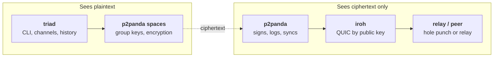

# triad

A command-line chat built to check whether p2panda and iroh fit together into
one stack for encrypted group chat. One user holds any number of encrypted
spaces, each a named channel, as in an IRC client. iroh dials peers by public
key. p2panda keeps a signed append-only log per author, syncs it, and
encrypts every message with its built-in spaces. This is an exploration: the
code is disposable, and [FINDINGS.md](FINDINGS.md) is the deliverable.

An earlier `triad` encrypted with OpenMLS (RFC 9420), following
[SPEC.md](SPEC.md). That code was removed after the comparison in FINDINGS.md
came out in favour of spaces, and the spaces binary, until then
`triad-spaces`, took the name. The OpenMLS code is in the git history up to
`de3f814`, and the findings about it are kept. A data directory written by
the OpenMLS version (it has an `mls.sqlite`) is refused: move it away or pass
a fresh `--data-dir`.

## What the implementation is

One binary, `triad`. One data directory is one user: one identity and
one p2panda node, in any number of spaces. The app talks only to p2panda.
iroh runs inside p2panda, and p2panda encrypts every message before storing
or sending it.



| Layer | Library | Owns |
| --- | --- | --- |
| App | `triad`, `triad-core` | Channels and their names, invites, join prompts, readable history |
| Encryption and membership | p2panda 0.8.0 spaces | Group key agreement, encryption, member list and access levels |
| Log and sync | p2panda 0.8.0 | Signed append-only log per author, SQLite storage, discovery, catch-up |
| Transport | iroh 1.4.1 | QUIC connections dialed by public key, hole punching, relay fallback |

## Status

A prototype, not a reliable chat system. The two-machine acceptance run
passes across two networks
([Milestone 6](FINDINGS.md#milestone-6-p2panda-spaces-on-two-machines-2026-11-11)).
Several channels per user are tested on one machine only. FINDINGS.md lists
what an app still has to handle itself: a removed member is not told, a
removed member who reconnects looks like a new join request, and new members
can read messages from before they joined. p2panda's encryption is its own
protocol, not a standard, and is documented as subject to change before 1.0.

## Prerequisites

| Machine | Needs |
| --- | --- |
| macOS, Apple silicon | Xcode command line tools (`xcode-select --install`), `rustup` with stable Rust 1.96 or newer |
| Linux, x86_64 | A C toolchain (`build-essential` on Debian or Ubuntu), `rustup` with stable Rust 1.96 or newer |

The C compiler is needed because SQLite is compiled from bundled source and
the TLS backend includes C and assembly. `rust-toolchain.toml` pins the exact
toolchain; rustup installs it on first build.

No inbound ports are needed. Each node makes outbound UDP connections for
direct paths and outbound HTTPS to the relay.

## Install

The same command on both machines:

```sh
git clone https://github.com/jamesacklin/triad.git && cd triad
cargo install --path crates/triad --locked
triad whoami
```

`triad whoami` creates this install's identity and prints its node ID.
A clean build takes a few minutes.

## Use

On machine A:

```sh
triad create
```

It creates the channel `#general`, prints an invite (`triad1-…`) and enters
chat mode. On machine B:

```sh
triad join triad1-…
```

A is asked `join request for #general from 7c1d09ee. Accept? [y/N]`. After
`y`, both sides print that B joined. Then type a line and press Enter to send
it. Lines starting with `/` are commands.

Later, `triad chat` opens every channel again. Someone who has the
missed messages must be online for a member to catch up, because there is no
always-on node.

| Command | Behavior |
| --- | --- |
| `whoami` | Print the node ID. Create credentials if the data directory is new. |
| `create [--name <name>]` | Create a channel (default `general`), print its invite, enter chat mode. |
| `join <invite> [--name <name>]` | Add a channel from an invite, enter chat mode, wait to be added. |
| `chat [--channel <name>]` | Open every channel in chat mode, focused on the named or first one. |
| `channels` | List the channels in this data directory. |
| `invite [--channel <name>]` | Print an invite to a channel this node has joined. |
| `history [--channel <name>] [--limit N]` | Print stored messages, oldest first: one channel, or all in one timeline. |
| `status` | Print role, join status and operation counts for every channel. |
| `inspect --grep <text>` | Scan the raw bytes of `p2panda.sqlite` for the text. Exit 0 if absent, 1 if found. |
| `probe listen` | Start a raw iroh echo endpoint and print its address. |
| `probe connect <addr>` | Connect, echo one line, report whether the path was direct or relayed. |

| Flag | Applies to | Meaning |
| --- | --- | --- |
| `--data-dir <path>` | All | Use this data directory (default `~/Library/Application Support/triad` on macOS, `~/.local/share/triad` on Linux). |
| `--relay <url>` | `create`, `probe` | Override the default relay (`https://use1-1.relay.n0.iroh.link./`). Joiners take the relay from the invite. |
| `--auto-accept` | `create`, `join`, `chat` | Accept every join request, in every channel this node manages, without asking. |
| `--json` | chat mode | Print one JSON object per event (`ready`, `channel`, `switched`, `join_request`, `joined`, `removed`, `promoted`, `message`, `sync_started`, `sync_ended`, `error`). |
| `-v` | All | Also print sync and connection events. |

Exit codes: 0 success, 1 runtime error, 2 usage error.

One data directory is one user. To run two users on one machine, give each
its own `--data-dir`.

### Channels: several spaces per user

Each channel is its own p2panda space, with its own members, keys and
history. Chat mode opens all of them at once and tags every line with its
channel.

| In chat mode | Behavior |
| --- | --- |
| plain text | Send to the focused channel. |
| `/create <name>` | Create a channel, focus it, print its invite. |
| `/join <invite> [name]` | Join a channel and focus it. Messages there stay disabled until a manager adds you. |
| `/switch <name>` (`/s`) | Focus another channel. |
| `/msg <name> <text>` | Send to a channel without switching. |
| `/channels` (`/list`) | List channels; `*` marks the focused one. |
| `/invite [name]` | Print an invite to the focused or named channel. |
| `/members`, `/status` | Show the focused channel's members and counts. |
| `/add <node>`, `/remove <node>`, `/promote <node>` | Change the focused channel's membership. Needs `Manage` access. |
| `/quit` | Leave chat mode. |

Names are local labels: 1 to 32 characters of `a-z`, `0-9`, `-` and `_`, with
an optional leading `#`. An invite carries the inviter's name as a suggestion.
If that name is taken, the joiner gets it with the space ID appended, or
passes its own. Every JSON event about a channel has a `channel` field.
`ready` describes the focused channel and lists all of them in `channels`.

There is no `/leave` yet. A `state.sqlite` from before channels is migrated
on first open, and its group becomes `#main`.

## Local web demo

`triad-web` serves a small chat page for trying multiple Triad identities
inside one Rust process. Each identity has its own keys and SQLite files
and can create or join one p2panda space.

```sh
cargo run --locked -p triad-web
```

Open the local address printed at startup (by default
`http://127.0.0.1:8765`). Create an identity and a room, then copy the
invite link into a second tab and create a second identity there. The
raw invite code under **Details** also works with the current CLI via
`triad join <invite-code>`. To join a CLI-created room in the browser,
paste its invite code into the **Room invite** field.

The demo binds its web interface to loopback and automatically accepts
invite holders in rooms it creates. It stores credentials and decrypted
history under `demo-data/` by default. Use `--data <dir>` to choose another
directory. After a restart, opening a saved identity reconnects its room.
The browser enables the incoming message chime after you interact with the
page. Set a nickname under **Details**. Triad shares the change as an
encrypted room event. The current name appears on all messages from that
identity in the room, including earlier ones. Pass `--nickname "Sam"` to set
your nickname in the channels the CLI opens, or `--nickname ""` to clear it.
Peers with older clients can still exchange chat and show node IDs.

## Acceptance run (two machines)

Put the machines on different networks, for example the Mac on home Wi-Fi and
the Linux machine on a cloud VM or a phone hotspot. Both machines need
`triad` installed as above.

1. Mac: `triad create --auto-accept -v`. Copy the invite.
2. Linux: `triad join <invite> -v`.
3. Both: confirm the output shows 2 members.
4. Mac: send `mac-01` through `mac-10`. Linux: send `linux-01` through `linux-10`.
5. Both: `triad history` lists 20 messages, with each sender's messages in order.
6. Linux: `/quit`. Mac: send `mac-11` through `mac-15`.
7. Linux: `triad chat -v`. Expect one sync and exactly five new messages.
8. Both: `/quit`, then `triad inspect --grep mac-01` and `triad inspect --grep linux-01`. Both must exit 0.
9. Both: `triad status` shows `failed=0`.
10. Repeat steps 1 to 5 with fresh data directories (`--data-dir`) and the roles swapped, so Linux creates and the Mac joins.
11. Run steps 1 to 5 once more with both machines on the same LAN, and note whether the connection path changes.

Before step 1, a raw connectivity check is useful: `triad probe listen`
on one machine, then `triad probe connect <addr>` on the other. It
reports the path (direct or relayed) and the round-trip time.

`scripts/cross-test.sh user@other-host` automates steps 1 to 9 over SSH using
`--json` output, with fresh data directories on both sides. Set
`LOCAL_TAG`/`REMOTE_TAG` to name the messages; `scripts/cross-test.sh local`
runs both sides on one machine as a smoke test. If `triad` is not on
the remote's PATH for non-interactive SSH (usual for `~/.cargo/bin`), set
`REMOTE_TRIAD='~/.cargo/bin/triad'`.

### Reaching a machine behind carrier NAT

A machine on a phone hotspot can't accept incoming SSH. A Cloudflare quick
tunnel works around that without an account. Don't use Tailscale for this. It
gives iroh a tailnet path, so the run no longer tests two separate networks.

On the machine behind the hotspot (here, the Mac), turn on Remote Login,
add the other machine's public key to `~/.ssh/authorized_keys`, and run:

```sh
brew install cloudflared
caffeinate -dims cloudflared tunnel --url ssh://localhost:22   # prints <name>.trycloudflare.com
```

On the machine that runs the script, install `cloudflared` and add this to
`~/.ssh/config`:

```
Host *.trycloudflare.com
  ProxyCommand cloudflared access ssh --hostname %h
```

Then, for example, with Linux creating and the Mac joining:

```sh
REMOTE_TRIAD='~/.cargo/bin/triad' LOCAL_TAG=linux REMOTE_TAG=mac \
  scripts/cross-test.sh you@<name>.trycloudflare.com
```

The tunnel carries only the SSH session. iroh can't see it, so the chat still
connects across the two real networks.

Record the results in FINDINGS.md: path type, round-trip time, join latency
and catch-up time.

## If something fails

| Symptom | First check |
| --- | --- |
| The two nodes never see each other | Run `triad probe` between the machines. If the probe fails, the problem is the network or relay, not p2panda. |
| The joiner stays `pending` | Confirm a member with `Manage` access is online and printed a join request. Run both sides with `-v`. |
| `inspect` finds plaintext | Message text should never be in `p2panda.sqlite`. Keep the data directory and record the steps in FINDINGS.md. |
| The Linux build fails in a `-sys` crate | The C toolchain is missing. |
| macOS asks about incoming connections or local network access | Allow it; p2panda's mDNS discovery is on by default. |

Logs go to `triad.log` in the data directory (`RUST_LOG=debug` for more).

## Development

```sh
cargo test                       # unit tests, the two-node test and the channels test
cargo fmt --check
cargo clippy --all-targets -- -D warnings
cargo test -p triad --test spaces_membership -- --ignored   # offline membership, about a minute each
```

Layout: `crates/triad` (the binary and its integration tests),
`crates/triad-core` (message and invite formats, identity, `state.sqlite`),
`crates/triad-probe` (raw iroh echo, the only crate that names iroh).
