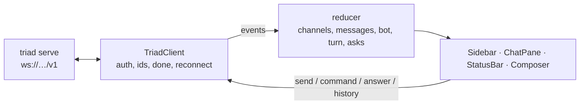

# Implementation plan: a React front end on the WebSocket API

2026-11-13 · draft for review · implementer: Claude Opus 5.5

## Goal

A small single-page app in `web/` that does what the terminal interface
does, in a browser, talking to `triad serve` over its WebSocket and nothing
else:

```
┌ channels ───────┐┌ #garden · 3 members · creator ───────────── [invite] ┐
│ ● agent (DM)    ││ sam   hello                                          │
│ ▸ garden        ││ me    @bot what's on the calendar?                   │
│   ops (…)     2 ││ bot   …                                              │
│                 ││                                                      │
│ [+ new] [join]  ││                                                      │
└─────────────────┘└──────────────────────────────────────────────────────┘
 bot on (mine) · anthropic · calendar │ turn 4s → calendar.list_events │ queue 1
 ⚠ join request for #garden from 7c1d09ee            [Accept] [Decline]
┌──────────────────────────────────────────────────────────────────────────┐
│ message #garden or /command                                              │
└──────────────────────────────────────────────────────────────────────────┘
```

React, Vite, TypeScript, Tailwind and shadcn/ui. No server of its own: the
build is static files, and all data comes over `ws://…/v1`. (Changed after
F5, 2026-11-13: `triad serve` serves the built files itself, with the `web`
feature; see "Follow-ups the user asked for" below.)

## Where things stand

- `triad serve` (PR #15, and #16 on axum) exposes one session at `/v1`.
  `API.md` is the reference and `openapi.json` has every request and event
  as a schema, discriminated on `op` and `event`.
- The terminal interface (`crates/triad/src/tui/`, README "Terminal
  interface") is the model for layout and behaviour: channel list, chat
  pane, status line, one input line where `/` starts a command.
- An earlier web demo (`crates/triad-web`) was deleted because it kept its
  own copy of the session logic. This one must hold none: it is a view on
  the socket.

Three facts about the API shape the design:

1. **Browsers cannot send the token in a header.** It goes in the first
   frame, so the page must be given the token by the user.
2. **`serve` refuses any `Origin` it was not told about.** The page's exact
   origin has to be passed with `--allow-origin`.
3. **The socket carries only JSON.** The TUI receives a ready-made text
   line with every event; a socket client does not. Every command reply
   the app shows, it has to render itself.

## Decided (recommendations; say if any is wrong)

**It lives in `web/` in this repository,** outside the cargo workspace,
with its own `package.json` and lockfile. pnpm, versions pinned exactly.
Nothing in `crates/` changes. (Reversed for serving the app: the routes and
the `web` feature are in `crates/triad`.)

**The stack is small.** React, Vite, TypeScript, Tailwind, shadcn/ui
components copied in by its CLI, Vitest. No router (one screen and a
connect dialog), no data-fetching library, no state library: one
`useReducer` store fed by the socket.

**One client class owns the socket.** `TriadClient` connects, sends the
`auth` frame, numbers requests, resolves a promise per request when its
`done` arrives (collecting the reply events that carry the same `re`), and
reconnects with backoff. Components never touch a `WebSocket`.

**Types come from `openapi.json`.** Generate them at build time and check
the generated file in, so the app fails to compile when the protocol
document changes shape. If the generator cannot handle a schemas-only
OpenAPI 3.1 file, write the types by hand from `API.md` and say so.

**The token is typed in, and kept only for the tab.** A connect screen
takes the address (default `ws://127.0.0.1:7878/v1`) and the token. Both
are kept in `sessionStorage`, so a reload reconnects and closing the tab
forgets them. A "remember on this device" box, off by default, uses
`localStorage`. The token is never put in a URL and never logged.

**Join requests are buttons.** The TUI reads the next plain line as y or
n; the API replaced that with `answer`, so the app shows Accept and
Decline.

**Focus and unread counts are the tab's own.** The API has no focus; the
app ignores `focused` on channel objects, as `API.md` says to.

**Known replies get real rendering; unknown ones get a JSON block.**
`info`, `error`, `members`, `invite`, `channels`, `grants`, `audit`,
`memory`, `schedules`, `prompt`, `bot` and `bot_model` are drawn as
notices or small tables in the focused channel. Anything else is shown as
formatted JSON, so a new command works before the app knows it.

**Messages are plain text,** with line breaks kept. No Markdown rendering.
(Reversed after F5: messages render Markdown; see below.)

**Development runs two processes.** `triad serve --allow-origin
http://localhost:5173` and `pnpm dev`. A script starts both. ~~Serving the
built files from `triad serve` itself is a follow-up (it needs a route on
the axum router, which AXUM-PLAN.md ruled out for now).~~ Done at the
user's request: see below.

## Design



```text
web/
  src/
    api/         types.gen.ts, client.ts (TriadClient), client.test.ts
    state/       store.ts (reducer + context), store.test.ts, selectors.ts
    components/  ConnectDialog, Sidebar, ChatPane, MessageList, Notice,
                 StatusBar, JoinRequestBar, Composer, CommandMenu,
                 InviteDialog, ReplyBlock
    components/ui/   shadcn components, as generated
    lib/         commands.ts (the command list and argument hints), format.ts
    App.tsx, main.tsx, index.css
```

**State.** Per channel: its `ready`/`channel` object, messages keyed by
`op` in arrival order, notices, unread count, whether the oldest page has
been reached. Global: connection status, my node, the bot summary from
`ready`, the running turn and its current tool call (from `job` and
`tool_call`), the queue depth, waiting join requests, the last error.

**Connection life cycle.**

| Event | The app does |
|---|---|
| Connect | Sends `auth`, waits for `hello` then `ready`, requests `history` for the focused channel. |
| Focus a channel | Requests its newest `history` page if it has none, clears its unread count. |
| Scroll to the top | Requests `history` with `before` set to the oldest `op`. |
| Close `4001` | Wrong token: forgets it and returns to the connect screen with the reason. |
| Close `4008`, or the socket drops | Reconnects with backoff (1 s doubling to 30 s), then `snapshot` and `history` per open channel, merging by `op`. |
| Close `4002` or `403` on connect | Shows what to fix (`--allow-origin <this page's origin>`). |

**shadcn components.** `sidebar`, `scroll-area`, `button`, `input`,
`textarea`, `badge`, `dialog`, `command` (the `/` menu), `popover`,
`tooltip`, `separator`, `table`, `sonner`. The theme follows the system
light or dark setting.

**Composer.** Enter sends, Shift-Enter adds a line. Text starting with `/`
goes as a `command` request with the focused channel; anything else as
`send`. Typing `/` opens a menu of commands, filtered as you type, with
channel names offered after `/msg` and `/invite`, as the TUI does.
`/switch <name>` is handled in the app (the API refuses it); `/quit` is
not offered.

## Milestones

Each ends with `pnpm lint`, `pnpm typecheck`, `pnpm test` and `pnpm build`
clean.

**F0 — Read and scaffold.** Read the current docs for Vite, Tailwind and
the shadcn CLI before running them; the versions on npm today (Vite 8,
Tailwind 4, TypeScript 7, shadcn 4, React 19) are newer than most training
data, and the set-up steps have changed between majors. Scaffold `web/`,
add shadcn, pin every version, add `web/node_modules` and `web/dist` to
`.gitignore`. Generate the types from `openapi.json`. Add
`scripts/web-dev.sh`, which starts `serve` with the mock brain and the
right `--allow-origin`, prints where the token is, and runs `pnpm dev`.

**F1 — Client and store, no interface.** `TriadClient` and the reducer,
tested with Vitest against a fake `WebSocket`: auth and `hello`/`ready`,
a request resolving on `done` with its replies, a failing request
rejecting with the error text, reconnect and merge by `op`, each close
code. Feed the reducer recorded frames from a real `serve` run, saved as
fixtures.

**F2 — Connect and read.** Connect dialog, sidebar, chat pane with
history paging and stick-to-bottom scrolling, unread counts. Check it in a
browser against a real `serve` with two identities.

**F3 — Write.** Composer, `send`, the `/` menu, `command`, reply
rendering, the JSON fallback, invite dialog with a copy button, new
channel and join.

**F4 — Bots and join requests.** Status bar (bot, running turn with a
clock, current tool call, queue, last turn's figures), the join request
bar, bot messages labelled as the TUI labels them.

**F5 — Finish.** Narrow-window layout (the sidebar collapses, as the TUI
hides it under 60 columns), keyboard focus order, empty and error states,
a `web/README.md`, a README section, and a FINDINGS.md section.

## Testing

- **Unit (Vitest):** the client and the reducer, as in F1. This is where
  protocol behaviour is pinned down.
- **By hand, in a browser, at every milestone from F2:** two data
  directories, one in the app and one in the TUI, exchanging messages,
  a join request, a bot turn with the mock brain, a `serve` restart
  mid-session.
- **No browser automation suite in this plan.** One Playwright run against
  a real `serve` is the first follow-up.

## Risks

- **Reply rendering is the long tail.** Twelve reply shapes, each small,
  none with a text form on the wire. If this turns out to be most of the
  work, the alternative is an API change: have `serve` include the text
  line it already computes. That is out of scope here; report it.
- **A message's own `done` does not name its `message` event.** The app
  shows a sent message when its `message` event arrives, not optimistically,
  so there is no duplicate to reconcile. On a slow network it will feel
  late. (Reversed after F5: sends are optimistic, matched to their echo by
  text; see below.)
- **The token in the page.** Any script running on the page's origin can
  read it. No third-party scripts, no analytics, no CDN fonts; everything
  is bundled.
- **Origin mismatch is the first thing every user hits.** `localhost` and
  `127.0.0.1` are different origins. The connect screen must say exactly
  which flag to pass.
- **Toolchain churn.** F0 exists so set-up is done from current docs.

## What this does not do

- ~~No server-side code, no route added to `triad serve`, no bundled
  hosting.~~ Reversed: `triad serve` serves the app (below).
- No accounts or multiple identities in one tab; one tab, one session.
- No ~~Markdown,~~ attachments, notifications, search or message editing.
- No mobile app. The layout works on a narrow window; that is all.
- No change to the protocol. Anything the app wants from it goes in
  FINDINGS.md as a follow-up.

## Rules for the implementing agent

1. Read the current docs for each tool before running or calling it.
2. Pin every dependency exactly. No dependency beyond the stack named
   above without saying why in FINDINGS.md.
3. The app holds no session logic. If a behaviour needs the app to guess
   what the session will do, stop and report it as a gap in the API.
4. Never log the token or put it in a URL.
5. Nothing under `crates/` changes.
6. Three attempts at a failing step, then stop and report.

### Questions the findings must answer

1. Did type generation from `openapi.json` work, and did the types catch
   anything?
2. Which reply events needed their own rendering, and how much of the app
   is that?
3. What did the app need that the protocol does not give? (Expected
   candidates: a text form for replies, the `op` of a sent message, join
   requests on reconnect.)
4. How does it behave when `serve` restarts, and when the network drops?
5. Bundle size, and the dependency count in the lockfile.

## Follow-ups the user asked for (2026-11-13, after F5)

These reverse four decisions above; FINDINGS.md "Web app" has the results.

1. **Served by triad.** `GET /` and `GET /assets/…` on the axum router,
   the files embedded from `web/dist` by `crates/triad/build.rs` behind a
   cargo feature `web` (not a default). The page's own loopback origins may
   open the socket without `--allow-origin`; they come from the bound
   address, never from `Host`. `index.html` carries a strict
   Content-Security-Policy.

2. **Optimistic sends.** A sent message shows at once, greyed out, and is
   settled by its `message` event, matched on channel, own authorship,
   text and action flag, oldest first. A failed `done` keeps it with the
   error, Retry and Discard; no echo in 30 s shows it as not confirmed.
3. **Markdown in messages.** People's and bots' messages render GFM
   Markdown through react-markdown and remark-gfm, safe by default: raw
   HTML stays text, links only http, https and mailto (new tab, `noopener
   noreferrer`), images shown as links, no highlighting. `/me` actions,
   notices and replies stay plain.
