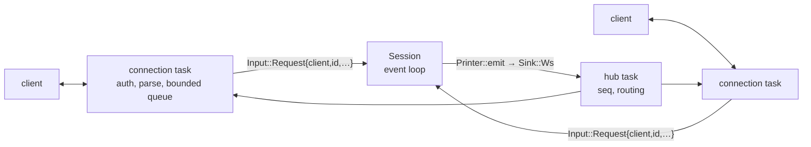

# Implementation plan: a WebSocket API on the triad process

2026-11-13 · draft for review · written against `df35e76`

The listener described here was later replaced by axum on hyper; see
`AXUM-PLAN.md` and FINDINGS.md, "axum under the listener".

## Goal

`triad serve` runs a chat session with no terminal and exposes it on a
WebSocket. Any number of clients (a web or mobile front end, a script, a
harness outside a microVM) connect, receive the session's events, and send
requests:

```text
$ triad serve --listen 127.0.0.1:7878
listening  ws://127.0.0.1:7878/v1
token      ~/.local/share/triad/api-token
```

```text
→ {"op":"auth","token":"…"}
← {"event":"hello","protocol":1,"version":"0.1.0","node":"7c1d09ee…","seq":1}
← {"event":"ready","channels":[…],"bots":true,…,"seq":2}
→ {"id":1,"op":"send","channel":"garden","text":"hello"}
← {"event":"message","channel":"garden","author":"7c1d…","text":"hello","op":"…","seq":3}
← {"event":"done","re":1,"ok":true,"seq":4}
→ {"id":2,"op":"history","channel":"garden","limit":50}
← {"event":"history","re":2,"channel":"garden","messages":[…],"seq":5}
← {"event":"done","re":2,"ok":true,"seq":6}
```

## Where things stand

- `Session` (`crates/triad/src/main.rs`) is one single-threaded `select!`
  loop. Everything it reports goes through `Printer::emit(json, text)` into
  a `Sink` (`Text`, `Json`, `Tui`). Everything it is told arrives as a text
  line on an `mpsc::Receiver<String>` and is handled by `on_line`.
- The `--json` events are already the wire vocabulary: 37 event names, each
  an object with `"event"` and usually `"channel"`. Every integration test
  drives them, so they are stable.
- The TUI proved the seam: a new sink and a new line source, with no emit
  site changed (FINDINGS.md, "Terminal interface").
- `tokio-websockets 0.13.3`, `hyper 1.12`, `httparse` and `sha1` are already
  in `Cargo.lock`.

Four things in the line protocol do not survive more than one client, and
they are what this plan actually has to design:

1. **Focus is session-global.** Plain lines and most commands act on
   `Session.focus`. Two clients would fight over it.
2. **No correlation.** A client cannot tell which `error`, `info` or
   `members` answers which thing it sent, or when a command has finished.
3. **A plain line can be an answer.** While a join request is waiting, the
   next non-command line is read as yes or no (`on_line`). Over a socket
   that would turn someone's chat message into a membership decision.
4. **No history.** The TUI reads `state.sqlite` directly for backlog. A
   remote client cannot.

## Decided (recommendations; say if any is wrong)

**A new mode, not a new process.** `triad serve` is `chat` with a fourth
`Mode`/`Sink`. It is in the same binary, behind a cargo feature `ws` that is
on by default. One process still owns the data directory.

**Serve is headless.** No TUI and no stdin alongside the socket in this
plan. Teeing the sink so `triad chat --listen` works is a follow-up; it is
cheap once the hub exists but doubles the test matrix.

**Events are the existing events, unchanged.** One JSON object per text
frame. The socket adds only: `seq` on every frame, `re` on frames that
answer a request, and four new events (`hello`, `done`, `history`,
`lagged`). `--json` output is byte-for-byte what it is today.

**Requests are objects, and none depends on focus.** Every request that
concerns a channel names it. Four typed operations cover what lines cannot
do safely; everything else goes through one generic operation, so the ~30
existing commands work on day one without a schema each:

| `op` | Fields | Does |
|---|---|---|
| `auth` | `token` | First frame, if the token was not in a header. |
| `send` | `channel`, `text`, `action?` | Publishes a message. Never read as an answer. |
| `answer` | `channel`, `member`, `accept` | Answers a join request. |
| `history` | `channel`, `limit?`, `before?` | Stored messages, newest last, paged by operation hash. |
| `snapshot` | | Re-sends `ready` to this client. |
| `command` | `channel?`, `line` | Runs a `/command` as if typed with that channel focused. |

`command` refuses `/quit`, `/switch`, `/s` and the `/debug-*` hooks. A
client keeps its own focus.

**Replies go to the asker, changes go to everyone.** Events emitted while a
request is being handled carry its `re`. Those in a fixed reply set (`info`,
`error`, `channels`, `members`, `invite`, `grants`, `audit`, `memory`,
`prompt`, `schedules`, `history`, `done`) go only to the requesting client.
Everything else (`message`, `joined`, `channel`, `nick`, `granted`, bot
events, sync events) is broadcast. Every request ends with exactly one
`done` carrying `ok` and, on failure, `error`.

**No replay buffer.** `seq` is a per-process counter so a client can see a
gap. On reconnect a client calls `snapshot` and `history` and drops
duplicates by `op` hash, as the TUI already does. A client that falls more
than 1024 frames behind is sent `lagged` and closed.

**The token is the identity.** Whoever holds it can send as the user, change
membership and drive the bot's tools. So:

- Listens on loopback by default. A non-loopback address needs
  `--allow-remote`, and the startup line says the socket is not encrypted.
- A 32-byte random token in `<data-dir>/api-token`, mode 0600, created on
  first `serve`. Always required. Accepted as `Authorization: Bearer` or as
  the first frame (browsers cannot set the header). Never in the URL.
  Compared in constant time; five seconds to authenticate, then close.
- A request with an `Origin` header is refused unless the origin was passed
  with `--allow-origin`. Without this any web page the user visits can open
  `ws://127.0.0.1:7878`.
- No TLS in the process. Remote use goes through SSH, a tunnel or a reverse
  proxy. The token is never logged above trace (HARNESS-PLAN rule 5).

## Architecture



- **`crates/triad/src/ws/`** (new, behind `ws`): `mod.rs` (listener, accept,
  upgrade, auth, origin), `hub.rs` (client table, `seq`, routing, lag),
  `proto.rs` (request parsing, the reply set, the refused commands).
- **Input.** `event_loop`'s receiver changes from `String` to
  `enum Input { Line(String), Request { client, id, op } }`. Stdin and the
  TUI wrap their lines in `Line`; nothing else about them changes.
- **Handling a request.** The session sets the printer's current request
  (a `Cell<Option<(ClientId, u64)>>`), and for `command` saves `focus`,
  sets it to the named channel, calls `on_line`, and restores it. Because
  the loop is single-threaded and `on_line` is awaited, everything emitted
  in between belongs to that request. It then emits `done` and clears the
  cell. `send` calls `Session::send_body` directly; `answer` calls `add` or
  drops the entry from `asks`; `history` calls `State::history`.
- **Output.** `Sink::Ws(tx)` sends `(value, Option<(ClientId, u64)>)` to the
  hub. No emit site changes.
- **Things that check `printer.json()`** (the clipboard copy in `/invite`,
  for one) become a check for "not interactive" so serve behaves like
  `--json`.

## Milestones

Each ends with `cargo fmt --check`, clippy `-D warnings`, and every existing
test passing unedited.

**W0 — Read and decide the upgrade path.** Read `tokio-websockets` 0.13.3's
docs and find which dependency already pulls it and with which features.
Confirm its server side exposes the request headers (`Origin`,
`Authorization`) before the upgrade is accepted. If it does not, do the
HTTP upgrade with `hyper` and hand the stream over. Record the choice and
the release binary's size before and after in FINDINGS.md.

**W1 — Listen and broadcast.** `serve` subcommand, `Mode::Ws`, `Sink::Ws`,
the hub, `hello` + `ready` on connect, `seq`, ping every 30 s, 1 MiB frame
limit, the lag rule. No auth yet, loopback only, read-only. Test: two
`--json` peers chat; a socket client on one sees the same `message` events
the pipe test sees.

**W2 — Token and origin.** Token file, both ways of presenting it, the
timeout, origin refusal, `--allow-origin`, `--allow-remote`. Tests: no
token, wrong token, late token, a disallowed `Origin`, a non-loopback bind
without the flag.

**W3 — Requests.** `Input`, the request cell, `send`, `command`, `done`,
reply routing. Tests: two clients send to different channels at once and
neither moves the other; a `members` reply reaches only its asker; a
failing command gives `done` with `ok:false`; `/quit` and `/switch` are
refused.

**W4 — Join requests and history.** `answer`; `history` with a `before`
cursor (needs a paged variant of `State::history`); `snapshot`. Tests: a
`send` while a join request waits is published and the request still
waits; accept and decline; paging through 120 messages with no duplicate
and no gap; reconnect and resync by `op`.

**W5 — Bots over the socket.** Nothing new should be needed: `job`,
`tool_call`, `bot`, `schedule_fired` are ordinary events. Test with the
existing brain double: ask the DM bot a question over the socket and see
the turn's events and the reply. Run `scripts/vm/chat-test.sh` with the
guest in `serve` and the host on the socket.

**W6 — Documentation.** `API.md`: every request, every event with its
fields (generated by reading the emit sites, then checked by a test that
fails when an event name is missing from the document), close codes, the
reconnect recipe. A short README section. A `FINDINGS.md` section.

## Risks

- **A long `on_line` blocks every client.** `/join` and `/create` await
  network work inside the loop. That is true of the TUI today; over a
  socket it is more visible. Measure in W3; moving them to tasks is a
  follow-up, not part of this plan.
- **Reply routing by event name is a list someone must maintain.** A new
  query command whose event is not in the reply set would be broadcast. The
  W6 test covers the documented names; the default for an unknown name
  under a request should be requester-only.
- **`serve` on an empty data directory with `--no-bot` fails**, because a
  session needs a channel to focus. Kept as is in this plan (same as
  `chat`), and reported as a clear error.
- **Two processes on one data directory.** Nothing here adds a lock. Check
  what happens today when `chat` is started twice and write it down.

## What this does not do

- No TLS, no accounts, no per-client permissions: one token, full access.
- No HTTP or REST endpoints, no static file serving, no bundled web client.
- No typed schema per command, and no typed event enum inside `Session`
  (TUI-PLAN constraint 5 still holds).
- No server-side replay or unread tracking.
- No TUI or stdin alongside the socket.
- No change to `triad-release`; the feature is in the default build.

## Rules for the implementing agent

The rules in HARNESS-PLAN.md apply unchanged: read the pinned version's
docs before calling it, hold the pins, existing tests are a contract, never
log a token, stay in scope, three attempts then stop, write FINDINGS.md as
you go. One more: `tokio-websockets` is the only dependency this plan may
add to a manifest, pinned exactly at the version already in `Cargo.lock`.

### Questions the findings must answer

1. Which upgrade path was used, and what did the feature add to the binary?
2. How long does the loop stall on `/join` and `/create`, as seen by a
   second client?
3. Did any emit site need changing? Which, and why?
4. Was the reply set right, or did real clients want some replies broadcast?
5. What does a browser client need that this protocol makes awkward?
